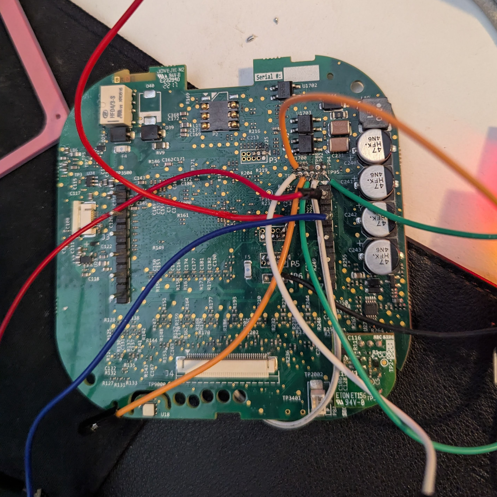
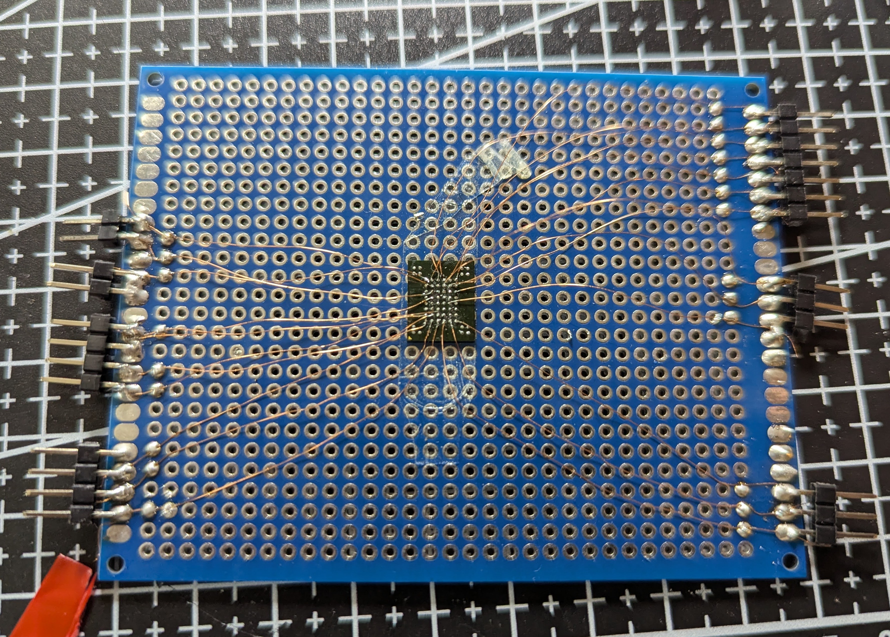
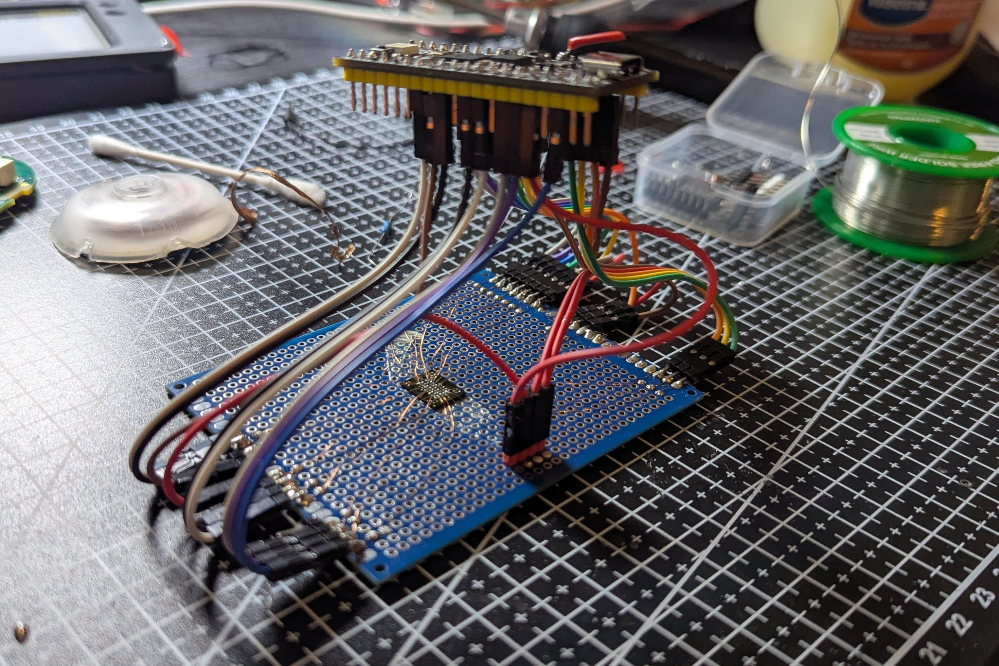

# I'm a Raccoon 

This whole adventure started with me at a thrift store. I've since learned that that's my kryptonite.

But while I was there, I decided to pick up an old **Ecobee 3 Lite** thermostat. It had a touch screen, WiFi, and a few other cool looking sensors. So I thought why not take it and try to put my own apps on it?

**So it begins**.


# Hoping its Easy (Reverse Engineering)

I didn't expect this to be a blog-worthy adventure when I started. I though a simple USB-Serial coverter and finding the right pins on the board would be the end of this adventure. 


What I would do after wouldn't really be anything challenging. A simple dashboard would scratch the itch of repurposing old tech. 


Lets start with what we can quickly find out:

- **Model:** Ecobee 3 Lite
- **Processor:** MCIMX283DVM4B
- **NAND Flash:** S34ML01G1008H100
- Some kind of capacitive touchscreen (looks like a MIPI connector)
- A SIM-card slot???

Now that I (kinda) knew what I was dealing with it was time to go ~~digging~~ soldering.



As you can see by the wire soup, there are plenty of test points on this device, and since its not a simple 2 layer PCB I couldn't visually track down the UART pins by finding the pinout, I had to multimeter brute force this.

Thankfully there are some predictable patterns I can look for. No one puts TX/RX on opposite sides of the connector (if you do, go seek help), and they are also unlikely to be the edge pads of a 10 pin connector so i can test those for power directly. 

What I ended up with was:

| ? | ? | ? | GND | RESET |
| - | - | - | --- | ----- |
| GND | RX | TX | ? | GND |

Which was good enough, I don't really need most of the other pads to get a simple shell going. 

Once I wired that up I had..... 


**Ugh.**

# Its Never That Easy

Great, now only to guess this completely random password! 

U-Boot has a 64 char limit so in the worst case I would only have to try... **5.16e+114** so as long as I live longer than the age of the known univere I should be able to break into this thrift store thermostat. 

**YAAAAY**

Thankfully I don't have to discover the secret to immortality before I discover the secret to U-Boot. There are known exploits for this exact thermostat and the folks at [L9Group discovered how to break into one of these](https://www.l9group.com/advisories/hard-coded-default-root-credentials-for-all-ecobee3-lite-devices/).

They found this:


Now, they didn't publish the plaintext password anywhere but by measuring the width of each character in that image and overlaying it in the redacted space, we can tell that the whole password is....


12 characters long. And we know 4 of them.

So all I actually need to guess is 9 alphanumeric + special characters so: 26 Upper Case + 26 Lower Case + 32 Special Chars + 10 Numbers = 94^9 = 

### 5.73e+17 possible combinations.

I needed a better way. 

# Not Cutting My Losses

At this point I would've given up. And I did, for about 3 months. But it kept whispering to me in my waking hours and appearing in my dreams. 

### And I was compelled to create this: 



Now you might be asking "why would you do this to yourself?", but the real question is "what's wrong with me".

*I admit, both are very good questions.*

I also found [a GitHub repo](https://github.com/MCMANIRX/AlmostFrii) for a Raspberry Pi Pico utility to read parallel NAND Chips like this one.

With some choice updates made to my own fork of it, we were ready to wire it up. 


**Wait wrong image**



Easy mistake to make.


# Finding the Password

Now that I had the NAND dump, I needed to parse the strings inside it. 

I can't tell you exactly what to do, I do believe that would be bad for my health. 

What I can tell you is that these tools are your friends. 

- strings
- binwalk
- ghidra
- ubireader


and this little helper to clear out the BCH metadata

```python
import numpy as np, bchlib

PAGE=2112; META=10; BLK=512; NBLK=4
bch = bchlib.BCH(4, m=13)                 # BCH-4, GF(2^13)
PAR = (bch.ecc_bits + 7)//8               # parity bytes per block

raw = np.fromfile("dump_raw.bin", np.uint8)
raw = raw[:len(raw)//PAGE*PAGE].reshape(-1, PAGE)

out = bytearray(); bad = 0; flipped = 0
for pg in raw:
    pos = META
    for b in range(NBLK):
        data = bytearray(pg[pos:pos+BLK]); pos += BLK
        ecc  = bytes(pg[pos:pos+PAR]);     pos += PAR
        res = bch.decode(data, ecc)
        if res is not None and res >= 0:
            bch.correct(data, ecc); flipped += res
        elif res is not None and res < 0:
            bad += 1
        out += data
open("corrected.bin","wb").write(bytes(out))
print(f"corrected bitflips: {flipped}, uncorrectable chunks: {bad}")
```


# Re-soldering and U-Boot Part 2

After finishing the above process, I had 2 things:

- The plaintext U-Boot interrupt password
- The entire rootfs filesystem

The second however, told me another annoying piece of information. **The root account no longer had a password**. 

The only way to get a shell here would be to pass `init=/bin/sh` into the U-Boot boot args.

Buuuuuuuuut... the Ecobee version of the OS did not like this, and panicked every time the existing init script didn't run. 

So I had to modify the existing init script itself to drop me into a root shell. 

# Making a RAMDisk Image

U-Boot allows copying an image over UART to load as a RAMDisk, a temporary boot partition loaded entirely into RAM which is wiped once the device is power cycled. 

I just had to find a busybox image for ARMv5 (yes this thing is a relic) and ask claude to make it a `ubootramdisk.img` file. 

After that the process was:

### Load the image into RAM

```bash
$ nand read ${loadaddr} 1F00000 400000
$ loadb 0x44000000 
# Use Tera Term to transfer the .img file to the EcoBee
$ run bootargs_default
$ setenv bootargs ${bootargs} rdinit=/init initrd=0x44000040,622942
$ bootm 0x42000000
```

### Mount the existing partition: 

```bash
$ busybox mkdir -p /proc /sys 
$ busybox mount -t proc proc /proc 
$ busybox mount -t sysfs sysfs /sys 
$ busybox mknod /dev/ubi0_0 c 253 1
$ busybox mkdir -p /mnt
$ busybox mount -t ubifs ubi0:rootfs /mnt -o ro
$ busybox cat /proc/mtd
$ busybox ls /mnt
adk     config  etc     idt     mnt     proc    sbin
tmp     var     bin     dev     home    lib     opt     
root    sys     usr
```

# The Final Stretch 

Now all that was left was to edit `/mnt/etc/inittab`

```bash title="/mnt/etc/inittab"
# starting up
::sysinit:/etc/rc.d/rcS
console::sysinit:-/bin/sh

ttyAM0::respawn:-/bin/sh # Uncomment this
#ttyAM0::respawn:-/usr/sbin/eco_login.sh # HAH CAN'T STOP ME NOW
```

And so, at long last:


Now I can sleep well, knowing that I have successfully broken into a 20 year old ARM device that can't run most browsers!

*I need to touch grass*